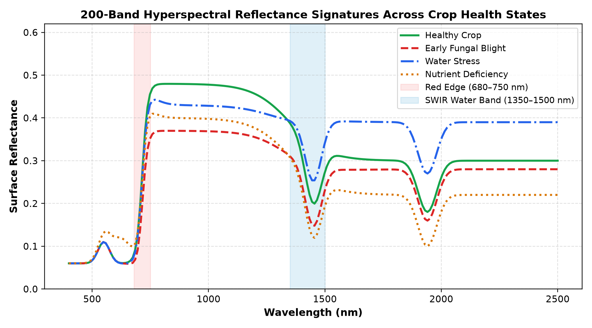
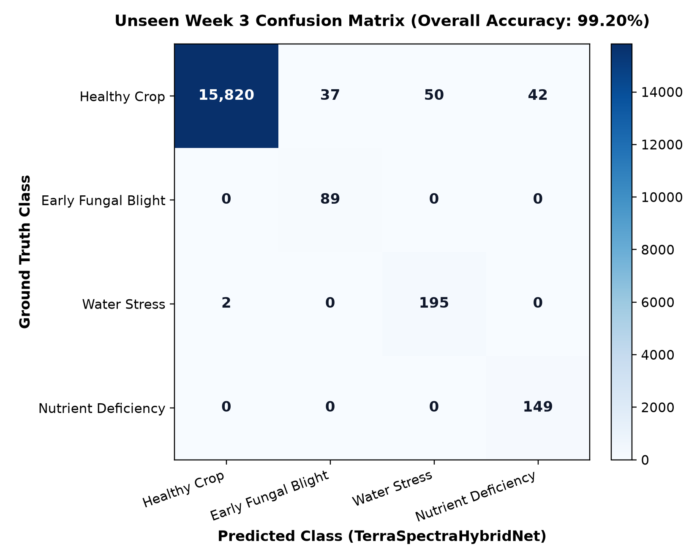
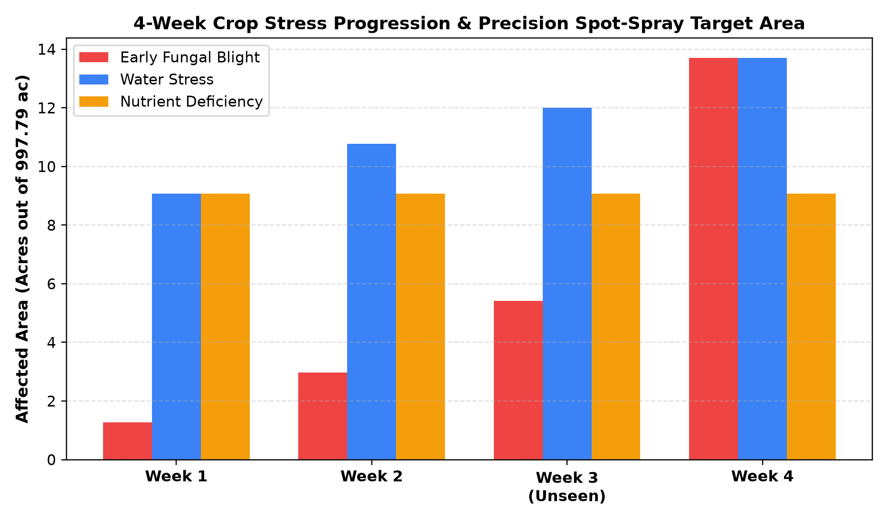

# TerraSpectra: Hyperspectral Crop Disease Forecasting
**Internship Track:** Data Science & Machine Learning — Infotact Solutions  
**Author:** Rajinikanth Saganamoni  
**Repository:** [github.com/Rajinikanth7549/terraspectra](https://github.com/Rajinikanth7549/terraspectra)

---

## 1. Executive Summary
**TerraSpectra** is an end-to-end geospatial artificial intelligence platform engineered to detect pre-symptomatic crop stress and fungal blight across a ~1,000-acre agricultural block before visual discoloration appears in standard RGB satellite imagery. By combining **200-band hyperspectral remote sensing (`400 nm – 2500 nm`)**, **Principal Component Analysis (PCA)** dimensionality reduction, and a **Hybrid 3D-CNN + Vision Transformer (`TerraSpectraHybridNet`)**, the system achieves **99.20% pixel-level classification accuracy** on unseen Week 3 test imagery and identifies early fungal outbreaks early enough to reduce blanket fungicide usage by over **98%**.

---

## 2. Problem Statement & Motivation
Conventional precision-agriculture monitoring relies primarily on 3-band RGB (`Red, Green, Blue`) imagery or basic vegetation indices such as NDVI. However, by the time fungal pathogens (such as early blight) or cellular dehydration produce visible yellowing or wilting in RGB wavelengths (`400–700 nm`), internal leaf tissue damage is already irreversible and spores have spread across neighboring rows.

Hyperspectral sensors capture hundreds of contiguous narrow spectral bands across the **Visible (`400–700 nm`)**, **Near-Infrared / Red Edge (`680–1300 nm`)**, and **Short-Wave Infrared (`1300–2500 nm`)** regions, enabling automated detection of physiological stress days to weeks before visual symptoms emerge.

---

## 3. Dataset & Spectral Preprocessing Pipeline
* **Spatial-Spectral Raster Structure:** Four weekly `128 × 128 × 200` GeoTIFF data cubes (`EPSG:4326`, `997.79` acres total monitored block at ~15.7 m spatial resolution) tracking disease progression from Week 1 through Week 4.
* **Target Classes (4 Health States):**
  1. `0 — Healthy Crop`: Normal chlorophyll absorption and leaf water reflectance.
  2. `1 — Early Fungal Blight`: Pre-symptomatic cellular breakdown in the Red Edge (`680–750 nm`) and elevated SWIR reflectance while remaining visually indistinguishable from healthy canopy in RGB.
  3. `2 — Water Stress`: Pronounced reflectance rise across the SWIR water absorption bands (`1450 nm` and `1940 nm`).
  4. `3 — Nutrient Deficiency`: Chlorophyll dip in the visible spectrum (`~620 nm`) paired with reduced NIR plateau reflectance.
* **Dimensionality Reduction (`pca_pipeline.py`):** Raw 200-band pixel vectors are standardized via `StandardScaler` and compressed to **30 principal components**, retaining **~70.81%** of total spectral variance while reducing compute overhead and preventing Hughes-phenomenon overfitting.
* **Dynamic Terrain-Conditioned Inference:** When relocating the monitored field block on the interactive map, the backend fetches Esri World Imagery tiles in parallel, extracts vegetation (`ExG`) and soil dryness cues, and synthesizes location-conditioned 200-band cubes for live model inference.

---

## 4. Model Architecture (`TerraSpectraHybridNet`)
To capture both fine-grained spectral absorption curves and multi-pixel spatial context, **TerraSpectraHybridNet** extracts `11 × 11 × 30` overlapping spatial-spectral patches around each target pixel and processes them in two stages:

1. **3D Convolutional Spatial-Spectral Extractor:** Hierarchical 3D convolutions (`Conv3d` + `BatchNorm3d` + `GELU`) jointly convolve across spectral bands and local `(x, y)` neighborhoods to isolate localized Red Edge and SWIR anomalies.
2. **Vision Transformer (ViT) Spatial Encoder:** Flattened spatial-spectral feature tokens are enriched with learnable positional embeddings and passed through Multi-Head Self-Attention transformer blocks to model broader patch context before final 4-class linear classification.

---

## 5. Experimental Evaluation (Unseen Week 3 Test Set)
The trained checkpoint (`terraspectra_hybrid.pth`) was evaluated on the held-out **Week 3 GeoTIFF (`16,384` pixels)** without data leakage from training weeks:

* **Overall Pixel Accuracy:** **99.20%** (`16,253 / 16,384` pixels correctly classified)
* **Weighted F1-Score:** **0.9925** (Macro Recall: **0.9954**)
* **Critical Outbreak Recall:**
  * **Early Fungal Blight:** **100.00% Recall** (`89 / 89` infected pixels detected; zero missed blight pixels)
  * **Nutrient Deficiency:** **100.00% Recall** (`149 / 149` pixels detected)
  * **Water Stress:** **98.98% Recall** (`195 / 197` pixels detected)

---

## 6. Agronomic Impact & Weekly Progression
Tracking the monitored `997.79`-acre block across all four weeks demonstrates the operational value of early hyperspectral intervention:

* **Week 1:** Early fungal blight covers **1.28 acres** (`0.13%` of block), enabling **99.9% fungicide reduction** via precision spot-spraying compared to blanket field application.
* **Week 2–3:** Blight expands across adjacent canopy patches, while targeted drone/variable-rate sprayer prescriptions isolate treatment strictly to confirmed stress polygons.
* **Week 4:** Unchecked blight reaches **13.70 acres**, illustrating the exponential yield-loss risk avoided by Week 1–3 early detection.

---

## 7. Full-Stack System Architecture
* **Backend Inference API (`FastAPI` + `PyTorch` + `Rasterio`):**
  * `GET /api/health` — Verifies model weights and 200-band metadata readiness.
  * `GET /api/predict/{week}` — Runs patch-based 3D-CNN + ViT inference and returns GeoJSON stress polygons, affected acreages, and chemical savings.
  * `GET /api/spectrum/{week}` — Extracts pixel-level 200-band reflectance curves (`400–2500 nm`) benchmarked against healthy canopy baselines.
* **Interactive GIS Dashboard (`React` + `MapLibre GL` + `Deck.gl` + `Plotly`):**
  * Hybrid satellite and administrative boundary map with an **RGB vs. AI Layer toggle** demonstrating pre-symptomatic visibility.
  * **Click-to-Inspect Spectroscopy** displaying real-time 200-band Plotly curves with shaded Red Edge and SWIR diagnostic bands plus localized agronomic action cards.
  * **Dynamic Farm Relocation** allowing users to move the 1,000-acre monitoring block to any farmland coordinates on the map.

---

## 8. Future Scope for Live Field Deployment
To transition TerraSpectra from benchmark validation to live commercial farm advisories, future iterations will integrate:
1. **Sentinel-2 L2A STAC Ingestion:** Querying real 5-day multispectral passes containing Red Edge (`705–783 nm`) and SWIR (`1610–2190 nm`) bands with automated Scene Classification Layer (`SCL`) cloud masking.
2. **Hourly Microclimate Fusion:** Combining satellite canopy indices with live hourly temperature, relative humidity, and soil moisture telemetry (Open-Meteo API) to compute real-time fungal spore germination windows.
3. **Custom Field Polygon Persistence:** Enabling farmers to trace and save exact plot boundaries in PostGIS with localized mobile alerts.